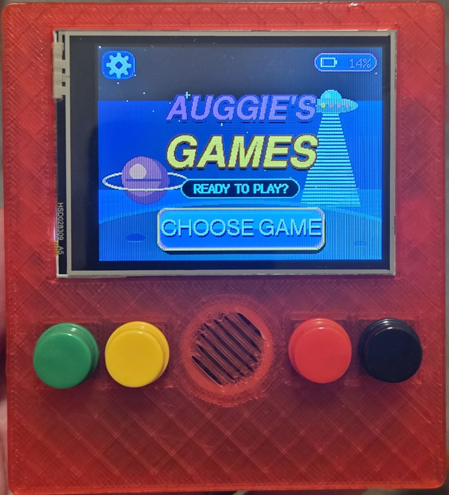
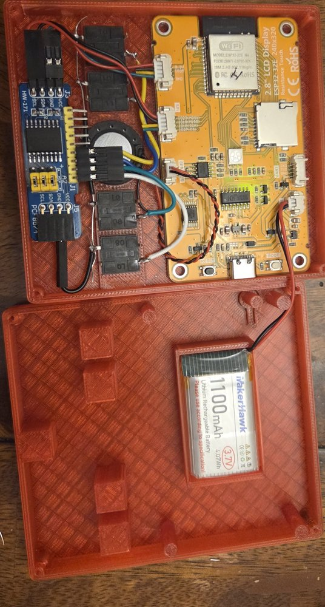
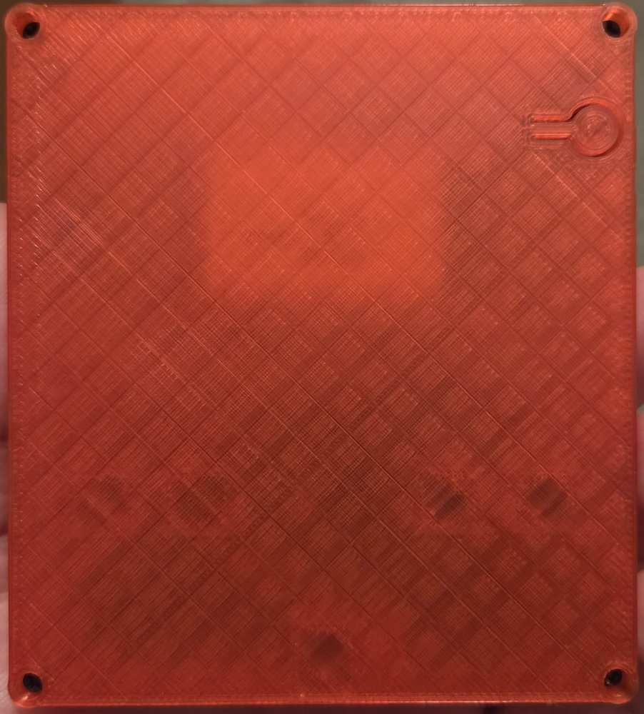

# Auggie's Games

A pocket-sized, handheld game console that my son Auggie and I built together, with games he designed himself.

  

## How it started

Auggie wanted to write his own video games, and he wanted his friends to be able to play them too. We looked at a lot of options: tablets, game-making apps, retro handhelds and hobby consoles. They were either expensive, locked down, or didn't let a kid build the whole thing himself.

After a lot of research, I realized that an **ESP32 display board** was exactly what we needed. It's a small, inexpensive circuit board (about the price of a pizza) with a color touchscreen, a speaker connector, Wi-Fi and a USB-C port already built in. You plug it into a computer, send it a program, and it runs that program as soon as it powers on. There's no operating system, no app store and no accounts.

We added to it along the way:

- A **PCF8574 I/O expander** gives us four real, clicky game buttons. The display board doesn't have enough free connections for buttons on its own.
- An **1100 mAh LiPo battery** makes it portable. The battery level shows in the corner of the home screen.
- A **3D-printed case** holds it all together. We designed it ourselves in [Tinkercad](https://www.tinkercad.com/), a free, beginner-friendly 3D design tool that runs in a web browser. It has cutouts for the screen, the four buttons and a speaker grille, a pocket for the battery, and posts that hold the boards in place.

**Auggie designed every game**: the ideas, the characters, the rules and what makes each one fun. We used [Claude Code](https://claude.com/claude-code) to help write the harder parts of the code, like 3D road drawing, smooth screen updates and button handling. Auggie could describe what he wanted, see it running on the device a few minutes later, and then say "make the cops faster" or "add a boss level." That quick back-and-forth kept him excited and is what made the project possible.

## What's on it

| Game | What you do |
| --- | --- |
| **Space Saucer** | Tap flying saucers before time runs out. |
| **Baby Yoda** | A virtual pet. Feed him, play a catch mini-game with him, and put him to bed. He remembers how he's doing even after the console is turned off. |
| **City Drive** | Race through a city at sunset, around curves and through traffic. Go over 75 mph and the police will chase you. |
| **Zombie Crash** | Pick a hero and a weapon, then fight through levels of zombies and a boss. |

There's also a settings screen for turning sound on or off and setting the volume.

## The hardware

  
  &nbsp;
  

On the left is the inside of the console. The top half of the case holds the yellow display board (the "brain" and screen), the blue PCF8574 button board, the four buttons and the speaker. The bottom half holds the battery. On the right is the back of the closed case, which is held together with four small screws. We designed the case together in Tinkercad, measuring each part and shaping the case around it, then printed it on a 3D printer.

### Parts list

| Part | What it does |
| --- | --- |
| 2.8" ESP32-32E display board (240×320 touchscreen) | The computer, screen, touch input, speaker output, battery charging and USB-C port, all on one board |
| PCF8574 I/O expander module | Reads the four game buttons and passes them to the display board over two wires |
| 1100 mAh 3.7 V LiPo battery | Powers the console; it charges through the board's USB-C port |
| 4 momentary push buttons | The game controls |
| Small speaker | Sound effects |
| 3D-printed case (designed by us in Tinkercad) | Holds everything together |

The parts we ordered on Amazon:

- https://www.amazon.com/dp/B0D92C9MMH
- https://www.amazon.com/dp/B0F9YSFV4T
- https://www.amazon.com/dp/B08YNBZQ5S
- https://www.amazon.com/dp/B0G2CRKZ4G

### How it's wired

You can do the wiring with plug-in jumper wires, without any soldering to the display board itself.

- **Buttons → PCF8574:** each button has two legs. One goes to a pin on the PCF8574 (P0, P1, P2 or P3) and the other goes to GND (ground).
- **PCF8574 → display board:** four wires: VCC to 3.3V, GND to GND, SDA to GPIO 19 and SCL to GPIO 23.
- **Speaker:** plugs into the board's speaker connector.
- **Battery:** plugs into the board's battery connector. Check that the red (+) and black (−) wires match the markings on the board before plugging it in.

[DISPLAY.md](DISPLAY.md) has the full technical details for anyone who wants them.

### How to play

- **Touchscreen:** tap anything on the screen.
- **Buttons in menus:** P0 and P1 move the gold highlight, P2 selects and P3 goes back.
- **Buttons in games:** each game uses them differently. For example, in City Drive P0/P1 steer, P2 is the gas and P3 is the brake.
- **BOOT button** (on the board): puts the console to sleep. Press it again to wake it up right where you left off.

---

## Make it your own: put your own games on it

You don't need to be a programmer to use this project. If you can install an app and describe a game in plain English, an AI coding assistant can write the code with you. Here's the whole process, step by step.

### Step 1: Build or buy the hardware

Get the parts above and assemble them as described in [How it's wired](#how-its-wired). If you only want to try it out, the display board by itself is enough. The games still work with the touchscreen, just without physical buttons or a battery.

### Step 2: Install the free tools on your computer

1. **Install [Visual Studio Code](https://code.visualstudio.com/)** (VS Code). This is a free app for working with code, and it works on Mac, Windows and Linux.
2. Open VS Code, click the **Extensions** icon on the left side (it looks like four squares), search for **PlatformIO IDE** and click **Install**. PlatformIO is what sends the games to the device. It may take a few minutes to finish setting up the first time.
3. **Windows only:** if your computer doesn't recognize the board when you plug it in, install the USB driver for the **CH340** chip (search for "CH340 driver").

### Step 3: Download this project

The easy way:

1. Go to https://github.com/jbborre/cheap-yellow-device.
2. Click the green **Code** button, then **Download ZIP**.
3. Unzip it somewhere you'll remember, like your Documents folder.

If you already use Git, you can run `git clone https://github.com/jbborre/cheap-yellow-device.git` instead.

### Step 4: Put the games on your device

1. In VS Code, choose **File → Open Folder…** and pick the `cheap-yellow-device` folder you just unzipped.
2. Plug the display board into your computer with a USB-C cable that carries data, not just power.
3. Click the **PlatformIO** icon (an ant head) on the left side.
4. Under **Project Tasks**, open the folder that matches your screen:
   - **ili9341**: the 2.8-inch board used in this build
   - **st7796s**: the larger 4-inch board
5. Click **Upload**. The first time takes a few minutes while it downloads what it needs. When you see **SUCCESS**, the device restarts and shows the menu.
6. **The first time it starts, it asks you to tap two crosshairs** to calibrate the touchscreen. Tap the center of each one.

If the upload can't find the device, unplug it and plug it back in, try a different USB cable, or hold the **BOOT** button on the board while the upload starts.

### Step 5: Write your own games with an AI assistant

This is the fun part. An AI coding assistant reads the project, writes the code, builds it and can even upload it to the device for you. You describe what you want, try it, and keep asking for changes.

You can use either **Claude Code** (by Anthropic) or **OpenAI Codex**. Both work the same way: you open this project folder and chat with them.

#### Option A: Claude Code

1. Install Claude Code by following the instructions at https://claude.com/claude-code. You can use it as a **VS Code extension** (search for "Claude Code" in VS Code's Extensions panel) or in a terminal window.
2. Sign in with your Claude account when it asks. A paid Claude plan or an Anthropic API account is required.
3. Open the `cheap-yellow-device` folder in VS Code, then open the Claude Code panel. If you're using the terminal, go into the folder and type `claude`.
4. Start with something like:

   > Read this project and explain how the games are organized. I'm not a programmer, so keep it simple.

5. Then describe your game (see [Good things to ask for](#good-things-to-ask-for) below).
6. Claude Code shows you each change and asks permission before running commands. When it's done, ask it:

   > Build it and upload it to my device using the ili9341 environment.

7. Play it, then ask for changes: "Make it easier," "Add a high score," "The jump feels too floaty."

#### Option B: OpenAI Codex

1. Install Codex by following the instructions at https://developers.openai.com/codex. It's available as a **VS Code extension** (search for "Codex" in VS Code's Extensions panel) and as a terminal app (`npm install -g @openai/codex`, then run `codex`).
2. Sign in with your ChatGPT account. Codex requires a ChatGPT plan that includes it, or an OpenAI API key.
3. Open the `cheap-yellow-device` folder, then start Codex from inside it.
4. Use the same prompts as in the Claude Code steps. Codex also shows its changes and asks before running commands.
5. To put the game on the device, ask Codex to run the upload. You can also click **Upload** in the PlatformIO panel yourself, as in Step 4.

#### Good things to ask for

The more you describe, the better the result. Tell the assistant **what the game is, how you win or lose, and which buttons do what.**

**A brand-new game:**

> Add a new game called "Dragon Dash" to the game list. A small dragon flies through a cave and has to dodge falling rocks. P0 moves up, P1 moves down, and P2 breathes fire to break rocks. You get a point for every rock you break. After 3 hits it's game over, and then it shows your score with a Try Again button. Put it in its own file in the include folder like the other games, and make it look colorful.

**Replacing a game:**

> Remove Space Saucer from the game list and replace it with a memory-matching game with 12 face-down cards. Tap two cards to flip them; matching pairs stay face up.

**Changing an existing game:**

> In City Drive, make the police appear after a quarter mile instead of half a mile, and add a second police car.

**Making it look nicer:**

> Improve the graphics of the Zombie Crash title screen.

**Helpful details to mention:**

- The screen is **320 × 240 pixels**, held sideways.
- There are **four buttons, P0–P3**, plus the touchscreen.
- Each game lives in its own file in the `include` folder and is added to the **game list** menu.
- If the AI changes something you don't like, say "undo that," or describe exactly what's wrong.

#### Tips

- **Make one change at a time** and test it on the device before asking for the next one. Small steps are easier to fix.
- **Save your progress.** If you use Git, ask the assistant to "commit these changes" after every version you're happy with. You can always go back.
- **If something breaks**, copy the error message into the chat and say "this happened when I uploaded." The assistant can usually fix it right away.
- **Let kids drive.** Auggie described what he wanted and decided what was fun. The AI did the typing. The ideas, the testing and the "no, make it like THIS" were all him.

### Step 6: Share it with friends

- **Friends with the same device:** send them a link to your copy of the project (for example, your own GitHub repository). They follow Steps 2–4 to put your games on their console.
- **Friends nearby:** plug their device into your computer and click **Upload**. It takes less than a minute.

---

## For the technically curious

- Built with [PlatformIO](https://platformio.org/) and the Arduino framework for the ESP32.
- Graphics are drawn to an off-screen 320×240 frame, and only the parts that changed are sent to the display, so animation stays smooth even over a slow connection.
- The same code runs on both the 2.8-inch (ILI9341) and 4-inch (ST7796S) boards; pick the matching build. [DISPLAY.md](DISPLAY.md) covers pins, wiring, battery sensing and performance.
- Settings, the pet's state and game unlocks are saved in the ESP32's built-in flash memory, so they survive power-offs.
